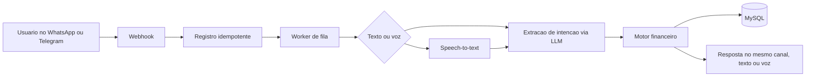
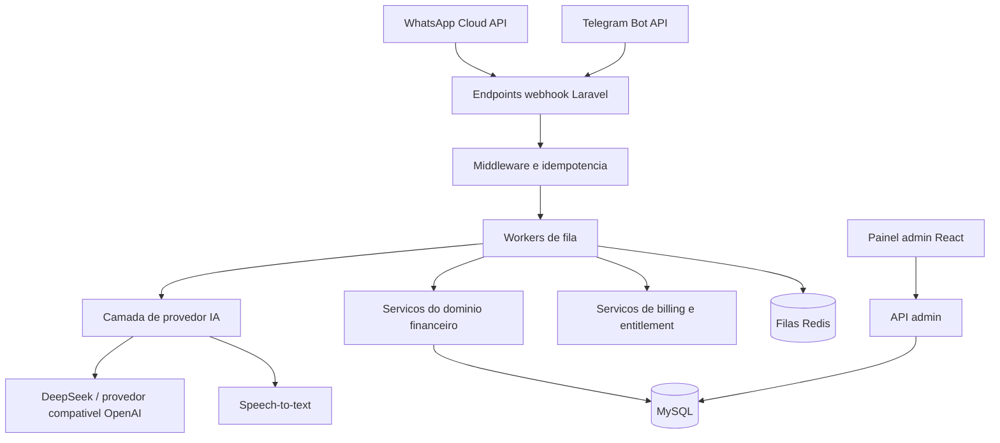

# Nix · Assistente IA

### IA / WhatsApp e Telegram / Automação / Assistente Financeiro

No ar em [assistenteia.online](https://assistenteia.online). *Finance AI* é o nome interno do projeto.

## Visão Geral

Nix é um assistente financeiro que funciona no WhatsApp e no Telegram. A pessoa conta o que gastou, por texto ou áudio, e ele mantém o registro, com relatórios, orçamentos e metas. O código é privado; este repositório documenta o produto como estudo de caso.

O produto combina mensageria no WhatsApp e no Telegram, entrada financeira em linguagem natural, processamento de voz, interpretação assistida por LLM, regras financeiras determinísticas, fluxos de assinatura/cobrança e painel administrativo.

Este repositório não contém código proprietário, credenciais, bot tokens, dados de usuários, dumps de banco ou secrets de provedores.

## Problema

Ferramentas de finanças pessoais geralmente exigem formulários estruturados, mas usuários descrevem gastos, receitas, compromissos e parcelas em linguagem conversacional.

O desafio de engenharia é permitir entrada flexível em linguagem natural sem deixar o modelo de IA virar a fonte da verdade financeira, enquanto o sistema também lida com retries de webhook dos dois canais, processamento assíncrono, estados de cobrança e privacidade.

## Solução

O código privado implementa um backend Laravel com ingestão de webhooks do WhatsApp Cloud API e do Telegram, processamento em filas, extração de intenção com LLM, serviços financeiros determinísticos, persistência MySQL, workers Redis/Horizon, cobrança via Mercado Pago e Telegram Stars e painel admin React/TypeScript.

O modelo ajuda a interpretar mensagens. O backend controla cálculo, validação, persistência e estado do usuário.

## Fluxo do Produto

## Arquitetura do Sistema

## Stack Técnica

- Backend: Laravel 13, PHP 8.3/8.4.
- Filas: Redis e Laravel Horizon.
- Banco de dados: MySQL.
- Admin frontend: React 19, TypeScript, Vite e Tailwind CSS.
- IA: provedor DeepSeek com opção compatível com OpenAI.
- Voz: transcrição local com whisper.cpp e fallback hospedado; respostas em áudio por síntese de voz.
- Mensageria: WhatsApp Cloud API (Meta) e Telegram Bot API.
- Cobrança: Mercado Pago e Telegram Stars.
- Observabilidade: integração Sentry no código privado.

## Engenharia Backend

O backend inclui webhooks do WhatsApp e do Telegram, uma camada de mensageria comum aos dois canais, roteamento de comandos, processamento conversacional, serviços financeiros, isolamento de usuário, assinaturas, cobrança Stars, reembolsos, automações de engajamento, métricas admin e endpoints de health/readiness.

Comandos passam por rotas determinísticas quando isso é mais seguro. Mensagens conversacionais passam por extração de intenção e validação backend antes de qualquer registro financeiro ser persistido.

## Dados / Banco de Dados

O modelo privado inclui usuários, updates Telegram, conversas, transações financeiras, compromissos, parcelas, orçamentos, recorrências, lembretes, uso de IA, registros de billing, ledger de Stars, logs de auditoria e métricas administrativas.

Valores monetários são representados em centavos inteiros para evitar drift de ponto flutuante.

## Integrações

- WhatsApp Cloud API para mensagens, áudios e botões.
- Telegram Bot API para mensagens, callbacks e cobrança por Stars.
- Mercado Pago para assinatura e checkout.
- DeepSeek para extração de intenção financeira.
- Speech-to-text para mensagens de voz.
- Redis/Horizon para processamento assíncrono.
- Sentry para visibilidade de erros.

## Segurança

Detalhes confirmados no código privado:

- Validação de assinatura/segredo nos webhooks do WhatsApp e do Telegram.
- Processamento idempotente de updates/webhooks.
- Tokens opacos em callbacks, sem embutir valores financeiros.
- API admin baseada em sessão com CSRF e TOTP 2FA opcional.
- Dados financeiros isolados por usuário.
- Validação backend antes da persistência.
- Nenhuma chave de provedor ou bot token publicada neste case.

## Desafios de Engenharia

- Manter a saída da IA como interpretação, enquanto serviços backend seguem como fonte da verdade financeira.
- Tratar retries de webhook sem duplicar transações.
- Suportar voz sem bloquear o caminho de resposta do webhook.
- Lidar com roteamento de modelos, timeouts, JSON inválido e falhas de provedor.
- Representar compromissos, parcelas, recorrências e gastos realizados de forma consistente.
- Implementar cobrança via Telegram Stars e estados de entitlement.
- Dar visibilidade administrativa sem expor dados privados de usuários desnecessariamente.

## Testes e Confiabilidade

O projeto privado contém testes para respostas DeepSeek, saída inválida/vazia da IA, retry e timeout, speech-to-text local, entrega de webhooks do WhatsApp e do Telegram, fluxos conversacionais, ciclo de vida de transações, isolamento de usuário, billing, ledger Stars, reembolsos, autenticação admin, métricas e inteligência financeira.

O runbook de deploy inclui health/readiness, workers de fila, scheduler, backup/restore e smoke tests.

## Infraestrutura e Deploy

A documentação privada descreve produção em VPS com Nginx, PHP-FPM, MySQL, Redis, workers, scheduler, Certbot, rotação de logs e automação de deploy.

Domínios, secrets, bot tokens e caminhos de servidor não são publicados.

## Produção

O projeto inclui runbooks de produção para deploy, configuração dos webhooks, workers, scheduler, health checks e controles operacionais. Este case expõe a arquitetura sem expor a superfície operacional real.

## Capturas de Tela

Capturas de tela não foram incluídas porque interfaces conversacionais e financeiras podem expor dados privados com facilidade.

## Meu Papel / O Que Construí

Este case demonstra backend, IA aplicada e automação: integrações WhatsApp e Telegram, serviços Laravel, desenho de workflow com LLM, lógica financeira determinística, filas, billing, painel admin com custo de IA por uso, testes e operação em produção.

## Decisões Técnicas Principais

- Usar LLM para interpretação, não como sistema de registro.
- Armazenar dinheiro em centavos inteiros.
- Processar webhooks de forma idempotente e assíncrona, nos dois canais.
- Manter payloads de callback opacos.
- Separar automação do usuário de operações admin e billing.
- Publicar estudo de caso seguro em vez de código privado.
