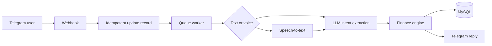
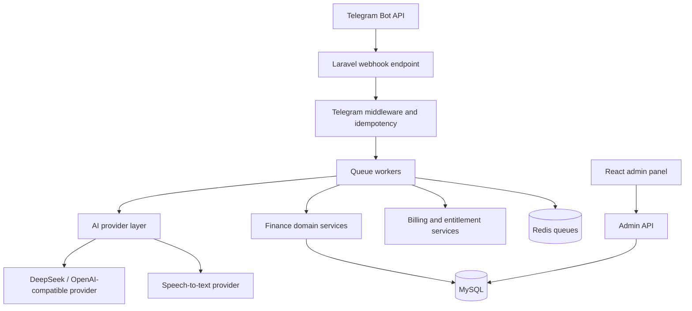

# Finance AI

### AI / Telegram / Automation / Financial Assistant

## Overview

Finance AI is a private Telegram-based financial assistant documented here as a safe public engineering case study.

The product combines Telegram automation, natural-language financial input, voice processing, LLM-assisted interpretation, deterministic finance rules, subscription/billing flows and an administrative dashboard.

This repository does not contain proprietary source code, credentials, bot tokens, production URLs, user data, database dumps or provider secrets.

## Problem

Personal finance tools often require structured forms, but users naturally describe expenses, income, commitments and installments in conversational language.

The engineering challenge is allowing flexible natural-language input without letting an AI model become the source of financial truth, while also handling Telegram webhook retries, asynchronous processing, billing states and privacy.

## Solution

The private codebase implements a Laravel backend with Telegram webhook ingestion, queue-based processing, LLM-assisted intent extraction, deterministic finance services, MySQL persistence, Redis/Horizon workers, Telegram Stars billing and a React/TypeScript admin panel.

The model helps interpret messages. The backend owns money calculation, validation, persistence and user state.

## Product Flow

## System Architecture

## Tech Stack

- Backend: Laravel 13, PHP 8.3/8.4.
- Queues: Redis and Laravel Horizon.
- Database: MySQL.
- Admin frontend: React 19, TypeScript, Vite, Tailwind CSS.
- AI: DeepSeek provider with OpenAI-compatible escape hatch.
- Voice: Local whisper.cpp flow with hosted provider fallback support.
- Messaging and billing: Telegram Bot API and Telegram Stars.
- Observability: Sentry integration in the private codebase.

## Backend Engineering

The backend includes Telegram webhook handling, command routing, conversation processing, finance domain services, user isolation, subscriptions, Stars billing, refunds, engagement automation, admin metrics and system health endpoints.

Commands bypass the model when deterministic routing is safer. Conversational messages go through intent extraction and backend validation before any financial record is persisted.

## Data / Database

The private data model includes users, Telegram updates, conversations, financial transactions, commitments, installments, budgets, recurring entries, reminders, AI usage, billing records, Stars ledger entries, audit logs and admin metrics.

Money is represented as integer cents to avoid floating-point drift in financial calculations.

## Integrations

- Telegram Bot API for messages, callbacks and Stars billing.
- DeepSeek for LLM-assisted financial intent extraction.
- Speech-to-text integration for voice messages.
- Redis/Horizon for asynchronous processing.
- Sentry for error visibility.

## Security

Security-relevant implementation details confirmed in the private codebase:

- Telegram webhook secret validation middleware.
- Idempotent webhook/update processing.
- Opaque callback tokens without embedding financial values.
- Session-based admin API with CSRF protection and optional TOTP 2FA.
- User-isolated finance data.
- Backend validation before persistence.
- No provider keys or bot tokens published in this case study.

## Engineering Challenges

- Keeping AI output advisory while backend services remain the financial source of truth.
- Handling webhook retries without duplicate financial transactions.
- Supporting voice input without blocking webhook response paths.
- Managing model routing, timeout, invalid JSON and provider failure cases.
- Representing commitments, installments, recurring transactions and realized spending consistently.
- Implementing Telegram Stars billing and entitlement states.
- Providing admin visibility without exposing private user data unnecessarily.

## Testing & Reliability

The private project contains tests for DeepSeek responses, invalid/empty AI output, retry and timeout behavior, local speech-to-text, Telegram webhook delivery, conversation flows, transaction lifecycle, user isolation, billing, Stars ledger, refunds, admin authentication, metrics and finance intelligence.

The deployment runbook includes health and readiness endpoints, queue workers, scheduler operation, backup/restore procedures and smoke tests.

## Infrastructure & Deployment

The private documentation describes a VPS-style production setup with Nginx, PHP-FPM, MySQL, Redis, queue workers, scheduler, Certbot, log rotation and deploy automation.

Exact production domains, secrets, bot tokens and server paths are intentionally not published.

## Production

The project includes production-oriented runbooks for deployment, Telegram webhook configuration, workers, scheduler, health checks and operational controls. This case study exposes the engineering architecture without exposing the live operational surface.

## Screenshots

Screenshots are not included in this repository because conversation and financial interfaces can easily expose private user data. Only sanitized captures should be added later.

## My Role / What I Built

This case demonstrates backend, AI-assisted product engineering and automation: Telegram integration, Laravel services, LLM workflow design, deterministic financial logic, queues, billing, admin tooling, tests and production deployment preparation.

## Key Engineering Decisions

- Use the LLM for interpretation, not as the system of record.
- Store money as integer cents.
- Make Telegram webhook processing idempotent and queue-backed.
- Keep callback payloads opaque.
- Separate user-facing automation from admin operations and billing controls.
- Publish a safe case study instead of private source code.
